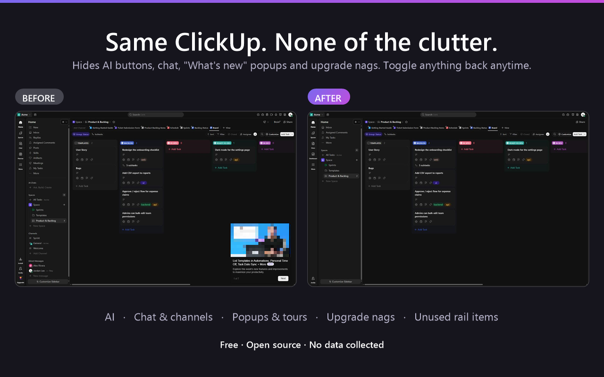
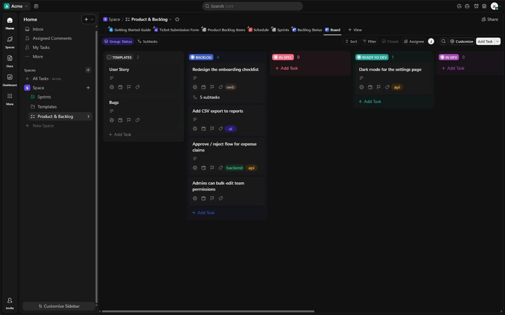
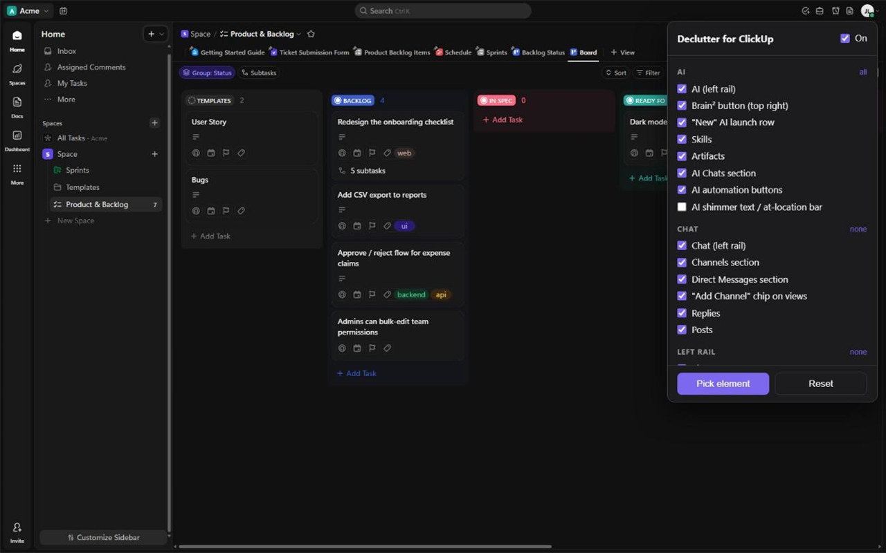

# Declutter for ClickUp

A Chrome extension that hides ClickUp's AI entry points, Chat/Channels/DMs, "What's new" popups, upgrade nags and unused rail items. Every item can be toggled, and **Pick element** hides anything else in two clicks.

- **Fast:** rules are applied as CSS before ClickUp renders, so nothing flashes on screen.
- **Safe:** it only changes how the page looks. Nothing in your workspace is changed or deleted.
- **Private:** no data collection, no network requests, no remote code. See [PRIVACY.md](PRIVACY.md).
- **Small:** only the `storage` permission, it only runs on `app.clickup.com`, and it has no dependencies.

## Install
**From the Chrome Web Store:** _coming soon_

**From source (Chrome, Edge, Brave):**
1. Download this repo (Code → Download ZIP) and unzip it, or `git clone` it.
2. Open `chrome://extensions` and turn on **Developer mode**.
3. Click **Load unpacked** and select the folder that contains `manifest.json`.
4. Reload your ClickUp tab.

## Use
- Click the toolbar icon to toggle items by group. Changes apply instantly.
- **Pick element**: hover over anything, use ↑/↓ to select the parent or child, then click or press Enter to hide it. Esc cancels. Picked items appear in the popup, and × brings one back.
- Uncheck **On** to see vanilla ClickUp again.

| | |
| --- | --- |
|  |  |

## What gets hidden
| Group | Hidden by default | Optional |
| --- | --- | --- |
| AI | AI rail item, Brain² button, "New" AI row, Skills, Artifacts, AI Chats, AI automation buttons | AI shimmer text / at-location bar |
| Chat | Chat rail item, Channels, Direct Messages, Replies, Posts, "Add Channel" chip | |
| Sidebar | Meetings | Inbox, Assigned Comments |
| Left rail | Planner, Teams, Whiteboards, Forms, Clips, Install, Upgrade | Goals, Timesheets, Dashboards, Docs, Invite |
| Top bar | SyncUp, record clip, talk to text, notepad | Reminder, Docs |
| Popups | "What's new" cards and tours, upgrade/automation banners, banner popups | |

## When ClickUp changes its UI
Selectors live in [`rules.js`](rules.js), one line per item. If something comes back after a ClickUp release, fix that line (PRs welcome) or just re-pick it.

## Development
- No build step. Edit the files, then click ↻ on the extension in `chrome://extensions`.
- `scripts/package.ps1` (Windows) or `scripts/package.sh` builds the store zip in `dist/`.
- `scripts/make-store-assets.ps1` regenerates the icons and store images from screenshots.
- Pushing a `vX.Y.Z` tag that matches the manifest version builds the zip and attaches it to a GitHub release.
- Store listing copy and dashboard answers are in [`store/listing.md`](store/listing.md).

## Security
See [SECURITY.md](SECURITY.md) for how to report a vulnerability.

## License
[MIT](LICENSE)

_Declutter for ClickUp is an independent project and is not affiliated with, endorsed by, or sponsored by ClickUp. "ClickUp" is a trademark of its respective owner. Screenshots use a demo workspace with made-up data._
